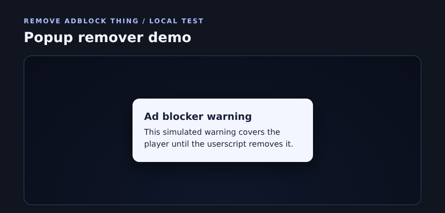

# Remove Adblock Thing

A userscript for YouTube that works alongside your existing ad blocker. It attempts to reduce playback interruptions and includes an optional ad-block warning popup remover. YouTube changes its player over time, so results may vary.

[Installation](#installation) · [Screenshots](#screenshots) · [Troubleshooting](#troubleshooting) · [Contributing](#contributing)

## Installation

1. Install [Tampermonkey](https://www.tampermonkey.net/) for your browser.
2. Open the [userscript installer](Youtube-Ad-blocker-Reminder-Remover.user.js?raw=true) and select **Install** in Tampermonkey.
3. Check that **Remove Adblock Thing** is enabled in the Tampermonkey dashboard, then reload any open YouTube tabs.
4. Keep your usual ad blocker enabled if you use one.

## Screenshots

These Chromium screenshots show the optional popup remover running against a [local test page](docs/popup-demo.html), not live YouTube. The demo enables `removePopup` and disables the other script modes to isolate popup removal. It does not test video playback or buffering.

**Before:** The simulated warning covers the player placeholder.

**After:** The userscript removes the warning and backdrop, revealing the player placeholder.

To enable this mode on YouTube, open the script in Tampermonkey, change `const removePopup = false;` to `const removePopup = true;`, save, and reload the tab.

[Watch the original project video](https://www.youtube.com/watch?v=jvSf10lgxs4).

## Troubleshooting

- **The script doesn't seem to run:** Verify it is enabled and that Tampermonkey has permission to run userscripts on `www.youtube.com`. Reload the tab after saving changes.
- **Warnings still appear:** Check whether the optional `removePopup` setting is enabled. Try disabling other YouTube userscripts one at a time to rule out conflicts.
- **Videos keep buffering:** Buffering can also be caused by network or browser issues. Compare with another video or a clean browser profile, and check whether browser-level or DNS-level filtering is involved.

## Contributing

Open an issue or pull request. For playback problems, include your browser, userscript manager, script version, and steps to reproduce. Remove any account details from screenshots or console logs.

## License

[MIT](LICENSE)

## Star History

<a href="https://star-history.com/#TheRealJoelmatic/RemoveAdblockThing&Date">
  <picture>
    <source media="(prefers-color-scheme: dark)" srcset="https://api.star-history.com/svg?repos=TheRealJoelmatic/RemoveAdblockThing&type=Date&theme=dark" />
    <source media="(prefers-color-scheme: light)" srcset="https://api.star-history.com/svg?repos=TheRealJoelmatic/RemoveAdblockThing&type=Date" />
    
  </picture>
</a>
